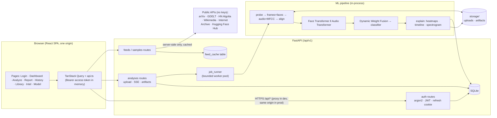

# PARALLAX — Audio-Visual Deepfake Forensics

> Working title. Multimodal deepfake detection web app: **Face Transformer + Audio Transformer + Dynamic Weight Fusion (AVT²-DWF)**, served through a FastAPI backend and a React bento-grid frontend with a full login system.
> This README is also the **master build prompt** for Antigravity: paste the rules in §2 once, then run the phases in §11 one by one.

---

## Contents

1. [What we are building](#1-what-we-are-building)
2. [Master rules for the agent (AGENTS.md)](#2-master-rules-for-the-agent-agentsmd)
3. [Technology stack](#3-technology-stack)
4. [System architecture & how frontend and backend connect](#4-system-architecture--how-frontend-and-backend-connect)
5. [ML pipeline logic (AVT²-DWF)](#5-ml-pipeline-logic-avt²-dwf)
6. [Design system](#6-design-system-midnight-black--electric-cobalt--acid-lime)
7. [Public APIs (no keys)](#7-public-apis-no-keys)
8. [Full file structure + purpose of every file](#8-full-file-structure--purpose-of-every-file)
9. [API contract & database](#9-api-contract--database)
10. [Antigravity plugins / skills and where to use them](#10-antigravity-plugins--skills-and-where-to-use-them)
11. [Build phases (layer by layer prompts)](#11-build-phases-layer-by-layer-prompts)
12. [Security checklist mapping (21 checks)](#12-security-checklist-mapping-21-checks)
13. [Run, test, deploy](#13-run-test-deploy)
14. [Appendix A — Production cleanup prompt](#appendix-a--production-cleanup-prompt)

---

## 1. What we are building

**Problem.** Single-modality detectors miss deepfakes where lips, face and voice are each individually convincing. The project report's answer is AVT²-DWF: two transformer encoders (face frames, audio MFCC) fused by a Dynamic Weight Fusion module that decides, per video, how much to trust audio vs. video.

**Product.** A real website where a signed-in user uploads a short video (or picks a public-domain sample) and gets a forensic report:

- Verdict: **AUTHENTIC / FAKE / INCONCLUSIVE** + calibrated confidence
- **Fusion balance**: how much the model leaned on audio vs. video for this clip
- **Timeline**: per-second fake probability for face, voice, and fused
- **Evidence**: most suspicious frames with attention heatmaps, spectrogram with anomaly overlay, lip-sync score
- History of all your scans, a live threat/research feed built from public APIs, and a Model Card page

**Reference repo:** `ALBIN-BENNY/Multimodal-Deepfake-video-and-audio-detection` currently contains only `frontend/`, `app.py`, `server.py`, `README.md`. This layout supersedes it; migrate anything useful, then delete the old files.

**Patterns inherited from the earlier Flask still-image project** (keep them): collision-resistant filenames, decode-to-verify uploads, decompression-bomb limits, traversal-safe downloads, `/health` endpoint, XAI heatmap overlay, honest "model output ≠ forensic proof" disclaimer.

### Honesty rules (non-negotiable)

- **Never hardcode or invent accuracy numbers.** The UI reads metrics from `weights/model_card.json`, written by `training/evaluate.py`.
- The report's numbers (≈0.91 accuracy controlled, ≈0.78 real-world, AUC ≈0.92) may appear on the Model Card page **only** labelled "reported in project report", next to the live numbers from the shipped checkpoint.
- `MODEL_MODE=untrained` (no checkpoint found) must show a persistent banner: *"Untrained weights — scores are not meaningful."* Never show a confident verdict from random weights.
- Every report carries: *"Probability reflects model confidence on this clip, not forensic proof."*

---

## 2. Master rules for the agent (AGENTS.md)

Create `AGENTS.md` at the repo root with exactly this content (Antigravity also reads workspace rules from `.agent/rules/` — copy it there if your version expects that):

```md
# Rules for every task in this repo

## Process
1. Read this README fully before the first edit. Work one phase at a time; do not start the next phase.
2. Before creating a file, check it is listed in README §8. If you need a file that is not listed, say why first.
3. Create only files that are needed now. No placeholder files, no empty "future" modules, no sample junk, no duplicate helpers.
4. After each phase: run its "Done when" checks, fix failures, and summarise in 5 lines. Do not suppress errors to pass checks.
5. Commit-sized changes. Never touch unrelated files.

## Code
- Backend: Python 3.12, FastAPI, SQLAlchemy 2, Pydantic v2, full type hints, `ruff` + `mypy --strict` clean.
- Frontend: React 18 + TypeScript strict + Vite + Tailwind v4 + Motion. No `any`, no console logs, no commented-out code.
- Secrets only from environment variables. `.env` is git-ignored; only `.env.example` (names, no values) is committed.
- All third-party/public API calls go through the backend (`feed_service`, `sample_service`). The browser only talks to our own origin.
- Every query that returns user data filters by the authenticated user id. Never trust a user id sent by the client.
- Never fabricate model metrics, results, or sample data presented as real.

## Design (zero "AI template" look)
- Follow `docs/design/DESIGN.md` (created in Phase 1). Tokens only; no hard-coded colours/sizes in components.
- Forbidden: purple/pink gradients, glassmorphism cards, floating blurred blobs, emoji in UI, Inter/Roboto/Poppins/Space Grotesk as primary fonts, centered hero + three identical feature cards, stock "Welcome back 👋" copy, identical rounded-2xl cards everywhere, lorem ipsum, generic icon-in-circle feature rows.
- Motion: transform/opacity only, 120–400 ms, `cubic-bezier(.2,.8,.2,1)`, respect `prefers-reduced-motion`, pause canvases when the tab is hidden.
- Accessibility: WCAG AA contrast, visible focus ring, keyboard-complete flows, semantic landmarks, alt text/aria labels.
- Copy is short, specific and technical. Labels read like instrument panels ("CH-V", "SYNC 0.82"), not marketing.

## Done means
Lint, types, unit/e2e tests and a production build all pass, and the feature works in the browser at 390 / 768 / 1280 / 1920 px.
```

---

## 3. Technology stack

All existing, widely used technologies — nothing exotic.

| Layer | Choice | Why |
|---|---|---|
| Language (ML + API) | Python 3.12 | Matches report (PyTorch, OpenCV, Librosa) |
| ML | **PyTorch**, `timm` (ViT-B/16 backbone), `torchaudio`/**Librosa** (MFCC, log-mel) | Face/Audio Transformer encoders + DWF |
| Video / face | **FFmpeg**, **OpenCV**, MediaPipe Face Detection (Haar cascade fallback) | Frame extraction, face crop/align |
| API | **FastAPI** + Uvicorn, Pydantic v2 | Typed contract, async uploads, SSE |
| DB | **SQLite** + SQLAlchemy 2 + Alembic | Zero-ops, matches report's SQLite module; swap URL for Postgres later |
| Auth | **argon2-cffi** password hashing, **PyJWT** access tokens, rotating refresh cookie | Proper login without third-party keys |
| Rate limit | **slowapi** | Login/register/upload throttling |
| Frontend | **React 18 + TypeScript + Vite** | Fast, typed |
| Styling | **Tailwind CSS v4** (tokens via `@theme`) + CSS grid/container queries | Bento layout, no UI-kit look |
| Motion | **Motion** (`motion/react`), Canvas 2D | Signal/scan/waveform animations |
| Data | **TanStack Query**, React Router, react-hook-form + zod | Caching, routing, validation |
| Charts | `d3-scale` + `d3-shape` + hand-built SVG | Custom look, tiny bundle |
| Fonts | Fontsource self-hosted: **Anybody** (display, variable width), **Hanken Grotesk** (text), **Martian Mono** (data) | Distinct, no external font requests |
| Tests | pytest, **Playwright** (+ `@axe-core/playwright`), ruff, mypy, eslint, tsc | Quality gates |
| Delivery | Docker multi-stage (frontend build → FastAPI serves `dist`) | One container, one origin |

---

## 4. System architecture & how frontend and backend connect



### Connection contract (the part people usually get wrong)

- **One origin.** Dev: Vite proxies `/api` → `http://127.0.0.1:8000`. Prod: FastAPI serves the built `frontend/dist` and `/api` from the same origin. No CORS in prod, so CSP can say `connect-src 'self'`.
- **Auth flow.** `POST /auth/login` returns a short-lived **access token** (JSON, kept in memory only — never localStorage) and sets a **refresh token** as an `HttpOnly; Secure; SameSite=Strict` cookie. `api.ts` attaches `Authorization: Bearer …`; on `401` it calls `/auth/refresh` once, retries, otherwise routes to `/login`. Refresh tokens rotate on every use and are stored hashed.
- **Upload → result flow.** `POST /analyses` (multipart) → validates → writes file → creates row `status=queued` → returns `202 {id}`. Frontend opens `GET /analyses/{id}/events` (SSE via fetch stream, so the Authorization header works) and renders stage events live; on `done` it fetches `GET /analyses/{id}`. Fallback: poll every 1 s.
- **Artifacts.** Frames, heatmaps and spectrogram PNGs are fetched through `GET /analyses/{id}/artifacts/{name}` (owner check + traversal guard), never as public static files.
- **Public data.** The browser never calls third-party APIs. `feed_service` / `sample_service` call them server-side with a `User-Agent`, short timeouts, an allow-listed host list, and a DB-backed TTL cache; if an upstream is down, the cached copy (or an empty state) is shown.

---

## 5. ML pipeline logic (AVT²-DWF)

**Stages (each emits an SSE event: `probe`, `frames`, `faces`, `audio`, `align`, `face_enc`, `audio_enc`, `fusion`, `explain`, `done`).**

1. **Probe** (`ffprobe`): require a video stream; reject if duration > `MAX_DURATION_S` (60), size > `MAX_UPLOAD_MB` (200) or resolution > 1920×1080. No audio stream → set `audio_present=false`.
2. **Frames + faces:** decode at 25 fps, sample `T=32` frames uniformly (sliding windows of 16, stride 8 for the timeline). Detect face per frame, keep the largest/most stable track (IoU linking), crop with 1.3× margin, resize 224×224, ImageNet-normalise. Frames with no face are skipped and counted (`face_coverage` in the report; below 40% → INCONCLUSIVE with reason).
3. **Audio:** FFmpeg → 16 kHz mono WAV → light denoise + peak-normalise → 40 MFCC + 64-band log-mel (25 ms window, 10 ms hop) → 1 s segments aligned to frame windows by timestamp.
4. **Face Transformer Encoder:** per-frame ViT-B/16 embedding → **n-frame tokenisation** (group `n=4` consecutive frame embeddings into one token) → linear to `d=256` → learned positional encoding → 4-layer, 8-head temporal Transformer → pooled `V ∈ ℝ²⁵⁶` plus per-window tokens.
5. **Audio Transformer Encoder:** MFCC/log-mel patches → linear to `d=256` → positional encoding → 4-layer, 8-head Transformer → pooled `A ∈ ℝ²⁵⁶` plus per-segment tokens.
6. **Dynamic Weight Fusion:** `g = softmax(MLP([A; V; |A−V|; cos(A,V)]))` → `(w_a, w_v)`; `F = w_a·A + w_v·V`; classifier MLP → 2-way softmax; temperature-scaled for calibration. If audio is missing, mask it so `w_a = 0`. Also output `sync_score` = mean cosine between time-aligned audio/face segment embeddings (lip-sync proxy).
7. **Verdict:** `p_fake ≥ 0.65` → FAKE, `≤ 0.35` → AUTHENTIC, else INCONCLUSIVE. Thresholds live in config, not in the UI.
8. **Explain:** attention rollout on the ViT for the top-K (5) most suspicious frames → heatmap overlay PNGs; spectrogram PNG with per-segment anomaly overlay; `timeline` JSON `[{t, p_face, p_audio, p_fused}]`.

**Training (offline, `backend/training/`).** Manifest CSV per dataset (DF-TIMIT, FakeAVCeleb, DFDC — downloaded manually under their licences; this is the only step that is not "no key"). Split **by identity**, not by clip, to avoid leakage. AdamW + cosine LR, class-balanced sampler, augmentations from the report (flip/rotate/crop, frame-interval sampling, noise, pitch shift, cross-modal mismatched pairs). `evaluate.py` reports accuracy, precision, recall, F1, AUC, confusion matrix, **and a cross-dataset test**, then writes `model_card.json`. Output checkpoint → `backend/app/ml/weights/avt2_dwf.pt` (git-ignored, `.gitkeep` only).

**Performance budget.** CPU: ≤ 60 s clip analysed in under ~60 s; use `torch.inference_mode`, batched frames, `torch.set_num_threads`. CUDA: fp16 autocast. Concurrency: bounded semaphore (default 2 jobs).

---

## 6. Design system: midnight black · electric cobalt · acid lime

**Concept: "forensic signal bench."** The UI behaves like lab instrumentation: crop-mark corners on cells, monospaced readouts, scanlines, waveforms. Nothing decorative that doesn't carry signal.

### Colour tokens (`styles/tokens.css`)

| Token | Value | Role |
|---|---|---|
| `--black-950` | `#04060B` | Page canvas |
| `--black-900` | `#080B12` | Cell surface |
| `--black-800` | `#0F141E` | Raised surface / inputs |
| `--line` / `--line-strong` | `#1B2231` / `#2A3550` | Hairlines, borders |
| `--cobalt-500` | `#1F4DFF` | **Electric cobalt** — structure, focus rings, active nav, video modality (fills/borders/large text) |
| `--cobalt-300` | `#8BA3FF` | Cobalt for small text (AA on black) |
| `--lime-400` | `#C8FF2E` | **Acid lime** — signal: primary CTA, AUTHENTIC, live indicators, audio modality |
| `--lime-ink` | `#0B1200` | Text on lime |
| `--text-100 / 300 / 500` | `#EEF2FA / #A9B3C7 / #6B778F` | Text scale |
| `--alert-500` | `#FF4D5E` | **Only** for FAKE verdict and errors (single functional extra) |

Rules: black is 80% of the surface, cobalt 15%, lime ≤ 5% (it must stay rare to read as signal). Cobalt-500 on black is ~3.4:1 — never use it for body text. FAKE verdicts also use a hazard-stripe pattern, so meaning never depends on colour alone.

### Typography

- **Display:** Anybody (variable width axis) — headings, verdict word, big numerals; animate `font-stretch` 60→120% on reveal.
- **Text:** Hanken Grotesk, 15/22 body.
- **Data:** Martian Mono — timecodes, hashes, scores; 11 px uppercase micro-labels, `letter-spacing: .08em`.
- Fluid scale with `clamp()`; tight negative tracking on display. If a font package is unavailable, pick the nearest distinct families — never fall back to Inter/Roboto/Poppins/system-ui as the primary look.

### Layout — bento grid

- 12-column CSS grid, 12 px gap, 8 px baseline, cells radius 10 px, 1 px hairline border, no shadows; corner **crop marks** (4 small L-shaped ticks) are the signature detail, plus a mono label in the top-left of each cell (`CH-V`, `SYNC`, `INTEL`).
- Pages declare **named grid areas** per breakpoint and use **container queries** inside cells so each cell reflows by its own width.
- Breakpoints: ≥1280 → 12 cols · 768–1279 → 6 cols · <768 → 1 col with priority ordering; left **command rail** becomes a bottom tab bar on mobile.
- App shell: left command rail (icon + label) + top **status strip** (model version, `trained/untrained` mode, queue length, API health dot).

### Motion vocabulary (all tied to the theme)

1. **Login `SignalStage`:** left half is a canvas — procedural face point-cloud scanned by a lime scanline, with an audio waveform below that alternates between smooth ("real") and jittery ("synthetic"). Right half is the form. No stock imagery.
2. **Pipeline rail:** stages light up in sequence; extracted frames "develop" one by one onto a contact sheet; the waveform draws in as audio decodes.
3. **Verdict reveal:** score counts up, display word widens via `font-stretch`; AUTHENTIC = one lime pulse, FAKE = a single 300 ms RGB-split glitch (never looping).
4. **Fusion balance:** a seesaw bar settles to `w_a` vs `w_v` with a spring.
5. **Linked scrubbing:** one shared time cursor across frame strip, spectrogram and timeline chart.
6. **Route transitions:** 240 ms scanline wipe.

### Screens

`/login` · `/register` · `/app` Dashboard · `/app/analyze` · `/app/analyses/:id` Report · `/app/history` · `/app/library` · `/app/intel` · `/app/model` · `/app/settings`

Dashboard bento cells: quick-analyze dropzone (wide) · scans this week (big numeral) · verdict split (stacked bar, not a pie) · recent analyses · average modality balance · **Threat pulse** (GDELT) · **Research radar** (arXiv) · system status.

---

## 7. Public APIs (no keys)

All proxied and cached by the backend. Phase 8 must first `curl` each endpoint and keep only those that respond; anything dead is dropped, not mocked.

| API | Endpoint (example) | Used for |
|---|---|---|
| **arXiv** | `http://export.arxiv.org/api/query?search_query=all:deepfake&sortBy=submittedDate` (Atom XML) | "Research radar" — newest deepfake-detection papers |
| **GDELT DOC 2.0** | `https://api.gdeltproject.org/api/v2/doc/doc?query=deepfake&mode=artlist&format=json` | "Threat pulse" — live news mentions |
| **Hacker News (Algolia)** | `https://hn.algolia.com/api/v1/search_by_date?query=deepfake&tags=story` | Secondary feed / trend sparkline |
| **Wikimedia Commons** | `https://commons.wikimedia.org/w/api.php?action=query&list=search&srnamespace=6&…&format=json` (send a descriptive `User-Agent`) | Public-domain sample images/audio/video for the Sample Library |
| **Internet Archive** | `https://archive.org/advancedsearch.php?q=…&output=json` + `https://archive.org/metadata/{id}` | Public-domain video clips for demo scans |
| **Wikipedia REST** | `https://en.wikipedia.org/api/rest_v1/page/summary/{title}` | Context cards for sample clips (who/what is in them) |
| **Hugging Face Hub (public)** | model files for ViT / audio backbones; `https://datasets-server.huggingface.co/rows?dataset=…` for public datasets | Backbone weights; optional dataset previews (verify the dataset exists in Phase 8) |
| **DiceBear** | `https://api.dicebear.com/9.x/shapes/svg?seed={userId}` | Generated user avatars |
| *(optional)* thispersondoesnotexist.com | plain image endpoint | Known-synthetic face stills, labelled "synthetic (ground truth)"; check its terms before use |

**Rules:** allow-list hosts in `SAMPLE_HOST_ALLOWLIST`; `POST /samples/{id}/analyze` downloads server-side with no redirects off-allow-list, a size cap and a timeout (SSRF guard). Cache TTL via `FEED_CACHE_TTL_S`. Always show source attribution and licence per sample.

---

## 8. Full file structure + purpose of every file

```
parallax/
├── README.md
├── AGENTS.md
├── .gitignore
├── .env.example
├── Dockerfile
├── docker-compose.yml
├── .github/workflows/ci.yml
├── docs/design/DESIGN.md
├── backend/
│   ├── pyproject.toml
│   ├── alembic.ini
│   ├── migrations/{env.py, versions/0001_init.py}
│   ├── app/
│   │   ├── main.py
│   │   ├── core/{config.py, security.py, deps.py, rate_limit.py, errors.py}
│   │   ├── db/{session.py, models.py}
│   │   ├── schemas/{auth.py, analysis.py, feeds.py, system.py}
│   │   ├── api/v1/{router.py, auth.py, analyses.py, samples.py, feeds.py, system.py}
│   │   ├── services/{auth_service.py, upload_service.py, job_runner.py, analysis_service.py, feed_service.py, sample_service.py}
│   │   └── ml/
│   │       ├── pipeline.py · inference.py · explain.py
│   │       ├── preprocess/{probe.py, video.py, audio.py, align.py}
│   │       ├── models/{face_encoder.py, audio_encoder.py, dwf.py, avt2_dwf.py}
│   │       └── weights/{.gitkeep, model_card.json}
│   ├── training/{manifest.py, dataset.py, augment.py, train.py, evaluate.py, configs/default.yaml}
│   └── tests/{conftest.py, test_auth.py, test_isolation.py, test_upload.py, test_pipeline.py, test_feeds.py}
└── frontend/
    ├── index.html · package.json · vite.config.ts · tsconfig.json · eslint.config.js · playwright.config.ts · .env.example
    ├── public/favicon.svg
    ├── src/
    │   ├── main.tsx · App.tsx · routes.tsx
    │   ├── styles/{tokens.css, base.css, bento.css}
    │   ├── lib/{api.ts, auth-store.ts, query.ts, sse.ts, format.ts, motion.ts}
    │   ├── types/api.ts
    │   ├── hooks/{useAuth.ts, useAnalysisStream.ts, useCursorSync.ts}
    │   ├── components/
    │   │   ├── ui/{Button.tsx, Field.tsx, Badge.tsx, Dialog.tsx, Skeleton.tsx, Toast.tsx}
    │   │   ├── layout/{AppShell.tsx, CommandRail.tsx, StatusStrip.tsx, ProtectedRoute.tsx}
    │   │   ├── bento/{BentoGrid.tsx, BentoCell.tsx}
    │   │   ├── viz/{SignalStage.tsx, WaveformCanvas.tsx, SpectrogramView.tsx, FrameStrip.tsx, ScanOverlay.tsx, VerdictDial.tsx, FusionBalance.tsx, TimelineChart.tsx}
    │   │   └── upload/{Dropzone.tsx, PipelineRail.tsx}
    │   └── features/
    │       ├── auth/{LoginPage.tsx, RegisterPage.tsx, authSchemas.ts}
    │       ├── dashboard/DashboardPage.tsx
    │       ├── analyze/AnalyzePage.tsx
    │       ├── report/ReportPage.tsx
    │       ├── history/HistoryPage.tsx
    │       ├── library/LibraryPage.tsx
    │       ├── intel/IntelPage.tsx
    │       ├── model/ModelCardPage.tsx
    │       └── settings/SettingsPage.tsx
    └── tests/e2e/{auth.spec.ts, analyze.spec.ts, responsive.spec.ts}
```

### 8.1 Repository root

| File | Purpose and logic |
|---|---|
| `README.md` | This document: build prompt, architecture, structure, runbook. |
| `AGENTS.md` | The persistent rules from §2 so every agent session follows the same constraints. |
| `.gitignore` | Ignores `.env`, `storage/`, `*.db`, `weights/*.pt`, `node_modules`, `dist`, `__pycache__`, Playwright reports. |
| `.env.example` | Variable *names* only: `APP_ENV, SECRET_KEY, DATABASE_URL, STORAGE_DIR, ACCESS_TTL_MIN, REFRESH_TTL_DAYS, COOKIE_SECURE, MAX_UPLOAD_MB, MAX_DURATION_S, MODEL_PATH, FEED_CACHE_TTL_S, SAMPLE_HOST_ALLOWLIST, MAX_CONCURRENT_JOBS, LOG_LEVEL`. No third-party keys exist in this project. |
| `Dockerfile` | Stage 1 builds the frontend; stage 2 is `python:3.12-slim` + `ffmpeg` + CPU PyTorch, copies `dist` into the app, runs Uvicorn as a non-root user. |
| `docker-compose.yml` | One service plus a volume for `storage/`; reads `.env`; healthcheck on `/api/v1/health`. |
| `.github/workflows/ci.yml` | On push: ruff, mypy, pytest, eslint, tsc, Vite build, Playwright smoke. |
| `docs/design/DESIGN.md` | The written design system produced in Phase 1 (tokens, type scale, grid areas, motion rules, component do/don't). Single source of truth for the UI. |

### 8.2 Backend — core

| File | Purpose and logic |
|---|---|
| `main.py` | Builds the FastAPI app: registers routers under `/api/v1`, security-headers middleware (CSP, HSTS, X-Content-Type-Options, Referrer-Policy), strict CORS (dev only), global exception handlers, loads the model once at startup, serves `frontend/dist` with SPA fallback in prod. |
| `core/config.py` | Pydantic `Settings` read from env; fails fast if `SECRET_KEY` is missing in production; exposes thresholds (`P_FAKE_HI/LO`), limits and paths. |
| `core/security.py` | Argon2 hash/verify, JWT create/decode (access, 15 min), refresh-token generation + SHA-256 hashing, constant-time compares. |
| `core/deps.py` | FastAPI dependencies: `get_db`, `current_user` (validates Bearer token, loads user), `owned_analysis(id)` (404 if not owner — same response as not found, so IDs can't be probed). |
| `core/rate_limit.py` | slowapi limiter keyed by IP (+ email on login); strict limits on `/auth/login`, `/auth/register`, `/analyses`. |
| `core/errors.py` | Domain exceptions → consistent JSON `{code, message}`; logs details server-side, returns generic messages to clients; logger setup (no secrets, no raw tokens). |

### 8.3 Backend — data & schemas

| File | Purpose and logic |
|---|---|
| `db/session.py` | Engine + session factory; SQLite pragmas (WAL, foreign keys on). |
| `db/models.py` | ORM tables: `User`, `RefreshToken`, `Analysis`, `AnalysisArtifact`, `FeedCache` (see §9). |
| `schemas/auth.py` | Request/response models for register/login/me with email + password-strength validation (length 12–128). |
| `schemas/analysis.py` | `AnalysisCreated`, `AnalysisSummary`, `AnalysisDetail` (verdict, `p_fake`, `w_audio`, `w_video`, `sync_score`, `timeline`, `frames`, `reasons`), SSE event shape. |
| `schemas/feeds.py` | Normalised feed items `{title, source, url, published_at}` and sample-library items with licence + attribution. |
| `schemas/system.py` | Health/ready and Model Card payloads. |

### 8.4 Backend — API routes (`api/v1/`)

| File | Purpose and logic |
|---|---|
| `router.py` | Aggregates all route modules under one prefix. |
| `auth.py` | `register`, `login`, `refresh`, `logout`, `me`. Login uses a generic "invalid credentials" message and a dummy hash on unknown email to equalise timing; refresh rotates the token and revokes the old one; reuse of a revoked token revokes the whole chain. |
| `analyses.py` | `POST /analyses` (multipart → 202), list (paginated, owner only), detail, **SSE events**, artifact stream, delete (removes DB rows + files). |
| `samples.py` | Lists curated public-domain samples; `POST /{id}/analyze` fetches an allow-listed URL server-side and starts a normal analysis. |
| `feeds.py` | `threats` (GDELT), `research` (arXiv), `pulse` (HN) — thin wrappers over `feed_service`. |
| `system.py` | `/health` (liveness), `/ready` (DB + model loaded), `/model` (version, mode, checkpoint hash, metrics from `model_card.json`). |

### 8.5 Backend — services

| File | Purpose and logic |
|---|---|
| `auth_service.py` | User creation (unique email, normalised), credential check, token issue/rotate/revoke, refresh-cookie settings. |
| `upload_service.py` | Streams upload to a temp file with a running byte cap, verifies extension **and** magic bytes **and** `ffprobe` decodability, SHA-256 hashes, stores under `storage/uploads/<uuid>.<ext>` (never the client filename), cleans up on failure. |
| `job_runner.py` | Bounded async worker (semaphore) that runs the CPU/GPU pipeline in a thread, pushes stage events into a per-analysis queue for SSE, marks `status` and `error`, enforces a per-job timeout. |
| `analysis_service.py` | Glue: create row, enqueue job, persist `AnalysisResult` and artifact records, delete cascade. Only place that touches both DB and ML. |
| `feed_service.py` | Fetches/parses arXiv (Atom), GDELT and HN with timeouts and a `User-Agent`; normalises; reads/writes `FeedCache`; falls back to stale cache on upstream failure. |
| `sample_service.py` | Queries Wikimedia Commons / Internet Archive for public-domain clips, stores licence + attribution, and performs the guarded server-side download (host allow-list, no foreign redirects, size/time caps). |

### 8.6 Backend — ML

| File | Purpose and logic |
|---|---|
| `ml/pipeline.py` | Orchestrates the stages in §5 as a generator that yields progress events; the only entry point the job runner calls. |
| `ml/preprocess/probe.py` | `ffprobe` wrapper (no shell, argument list, timeout): streams, duration, resolution, audio presence; enforces limits. |
| `ml/preprocess/video.py` | Decode at 25 fps, uniform + sliding-window sampling, face detection, IoU face tracking, 1.3× crop, resize/normalise; reports `face_coverage`. |
| `ml/preprocess/audio.py` | FFmpeg → 16 kHz mono, denoise/normalise, MFCC + log-mel, 1 s segmentation. |
| `ml/preprocess/align.py` | Aligns audio segments to frame windows by timestamp; handles missing audio/face gaps with masks. |
| `ml/models/face_encoder.py` | ViT-B/16 frame embeddings → n-frame tokenisation → temporal Transformer → `V` + window tokens. |
| `ml/models/audio_encoder.py` | MFCC/log-mel patch embedding → Transformer → `A` + segment tokens. |
| `ml/models/dwf.py` | Dynamic Weight Fusion: gating MLP over `[A; V; |A−V|; cos]`, softmax weights, modality masking, weighted sum, sync score. |
| `ml/models/avt2_dwf.py` | Assembles encoders + DWF + classifier head; `forward` returns logits, weights, and per-window/segment scores for the timeline. |
| `ml/inference.py` | Loads checkpoint once (sets `MODEL_MODE=trained/untrained`), runs the model in `inference_mode`, applies temperature scaling and verdict thresholds, builds the result dict. |
| `ml/explain.py` | Attention-rollout heatmaps for top-K frames, spectrogram PNG with anomaly overlay, timeline JSON; writes artifacts to `storage/artifacts/<analysis_id>/`. |
| `ml/weights/model_card.json` | Written by `evaluate.py`: dataset names, split policy, metrics, confusion matrix, cross-dataset results, checkpoint hash, date. The UI renders this file. |

### 8.7 Backend — training (offline)

| File | Purpose and logic |
|---|---|
| `training/manifest.py` | Builds per-dataset CSV manifests (path, label, identity, modality flags) and the identity-disjoint 80/20 split. |
| `training/dataset.py` | PyTorch `Dataset` returning aligned face-frame tensors + MFCC tensors + label, using the same preprocess modules as inference (no train/serve skew). |
| `training/augment.py` | Spatial, temporal, audio and cross-modal-mismatch augmentations from the report. |
| `training/train.py` | Training loop: AdamW, cosine LR, balanced sampler, mixed precision, early stopping on validation AUC, saves best checkpoint. |
| `training/evaluate.py` | Metrics, confusion matrix, cross-dataset test, ablation switch (`--static-fusion`) to prove DWF's contribution; writes `model_card.json`. |
| `training/configs/default.yaml` | Hyper-parameters (dims, layers, heads, `n`, lr, epochs, batch size) so runs are reproducible. |

### 8.8 Backend — tests & migrations

| File | Purpose and logic |
|---|---|
| `migrations/env.py`, `versions/0001_init.py` | Alembic setup and the initial schema. |
| `tests/conftest.py` | Temp DB/storage fixtures, authenticated client factory, tiny ffmpeg-generated test clip (3 s, sine tone + moving square). |
| `tests/test_auth.py` | Register/login/refresh rotation/reuse-revocation/logout, rate-limit, weak-password rejection. |
| `tests/test_isolation.py` | User B cannot list, read, stream or delete user A's analyses/artifacts (always 404). |
| `tests/test_upload.py` | Oversize, wrong magic bytes, extension spoof, zero-byte, over-duration, traversal filename, decompression-style abuse. |
| `tests/test_pipeline.py` | End-to-end on the synthetic clip with untrained weights: stages fire in order, result schema valid, `untrained` flag set, no crash on missing audio/no face. |
| `tests/test_feeds.py` | Parsers and cache fallback using recorded fixtures (no live network in CI). |

### 8.9 Frontend — config & entry

| File | Purpose and logic |
|---|---|
| `index.html` | Root, `lang="en"`, `theme-color` midnight, preload of the two critical font files. |
| `package.json` | Scripts: `dev`, `build`, `typecheck`, `lint`, `test:e2e`. Only dependencies actually imported. |
| `vite.config.ts` | React plugin, Tailwind plugin, dev proxy `/api → 127.0.0.1:8000`, manual chunks (react, motion, charts). |
| `tsconfig.json`, `eslint.config.js` | Strict TS, import-order and a11y lint rules. |
| `playwright.config.ts` | Projects for 390 / 768 / 1280 / 1920 px, `webServer` starts backend + frontend. |
| `public/favicon.svg` | Cobalt/lime mark (waveform inside a viewfinder bracket). |
| `src/main.tsx` | Mounts React, QueryClientProvider, router, global styles. |
| `src/App.tsx` | Providers + `AnimatePresence` route-wipe transition. |
| `src/routes.tsx` | Route table with lazy-loaded pages; everything under `/app` wrapped in `ProtectedRoute`. |

### 8.10 Frontend — styles, lib, types, hooks

| File | Purpose and logic |
|---|---|
| `styles/tokens.css` | Tailwind `@theme` block: colours, type scale, spacing, radii, easing, durations from §6. |
| `styles/base.css` | Resets, font-face (Fontsource imports), focus ring, `prefers-reduced-motion` overrides, selection colours. |
| `styles/bento.css` | Grid templates and named areas per breakpoint, crop-mark pseudo-elements, container-query rules. |
| `lib/api.ts` | `fetch` wrapper: base `/api/v1`, Bearer injection, single-flight refresh-on-401, typed errors, no token logging. |
| `lib/auth-store.ts` | Small in-memory store (access token, user); no localStorage/sessionStorage. |
| `lib/query.ts` | QueryClient defaults (staleTime per resource, no retry on 4xx). |
| `lib/sse.ts` | fetch-stream SSE reader with abort + reconnect/poll fallback. |
| `lib/format.ts` | Timecode, bytes, percent and relative-time formatters. |
| `lib/motion.ts` | Shared easing/duration constants and variants; central reduced-motion switch. |
| `types/api.ts` | TypeScript mirrors of backend schemas (kept in sync manually or generated from OpenAPI). |
| `hooks/useAuth.ts` | Login/register/logout mutations and session bootstrap (silent refresh on load). |
| `hooks/useAnalysisStream.ts` | Subscribes to an analysis' SSE, exposes `stage`, `progress`, `result`. |
| `hooks/useCursorSync.ts` | Shared time-cursor store used by frame strip, spectrogram and timeline. |

### 8.11 Frontend — components

| File | Purpose and logic |
|---|---|
| `ui/Button.tsx` | Primary (lime), secondary (cobalt outline), ghost; loading state; keyboard/focus complete. |
| `ui/Field.tsx` | Labelled input with mono hint, inline error, password reveal. |
| `ui/Badge.tsx` | Verdict/status chips (lime, alert + hazard stripe, neutral). |
| `ui/Dialog.tsx` | Accessible modal (focus trap, ESC) for delete confirmations. |
| `ui/Skeleton.tsx` | Scan-shimmer loading placeholders matching cell shapes. |
| `ui/Toast.tsx` | Minimal status toasts. |
| `layout/AppShell.tsx` | Rail + status strip + content outlet; swaps rail for bottom tabs on mobile. |
| `layout/CommandRail.tsx` | Primary navigation with active cobalt indicator and tooltips. |
| `layout/StatusStrip.tsx` | Polls `/model` and `/ready`: model version, trained/untrained badge, queue, health dot. |
| `layout/ProtectedRoute.tsx` | Redirects unauthenticated users to `/login?next=…` after attempting silent refresh. |
| `bento/BentoGrid.tsx` | Applies named grid areas for the current page; no content logic. |
| `bento/BentoCell.tsx` | Cell frame: label, crop marks, container-query context, optional busy state. |
| `viz/SignalStage.tsx` | Login hero: canvas face point-cloud + lime scanline + morphing waveform; pauses when hidden; static in reduced-motion. |
| `viz/WaveformCanvas.tsx` | Draws decoded audio peaks, supports progressive draw and cursor. |
| `viz/SpectrogramView.tsx` | Renders the backend spectrogram with anomaly bands over it. |
| `viz/FrameStrip.tsx` | Contact sheet of analysed frames; "develop" animation; click to inspect with heatmap toggle. |
| `viz/ScanOverlay.tsx` | Heatmap overlay with scanline reveal and opacity slider. |
| `viz/VerdictDial.tsx` | Verdict word + confidence ring with the width-axis reveal and glitch/pulse. |
| `viz/FusionBalance.tsx` | Seesaw bar of audio (lime) vs video (cobalt) weights. |
| `viz/TimelineChart.tsx` | SVG multi-line chart (face/audio/fused) with threshold bands and shared cursor. |
| `upload/Dropzone.tsx` | Drag/drop + picker with client-side pre-checks (type, size) — server remains authoritative. |
| `upload/PipelineRail.tsx` | Vertical stage list driven by SSE events with elapsed times. |

### 8.12 Frontend — features (pages)

| File | Purpose and logic |
|---|---|
| `auth/LoginPage.tsx` | Split layout: `SignalStage` + form; zod validation; generic error copy; `next` redirect. |
| `auth/RegisterPage.tsx` | Same shell; live password-strength meter; email uniqueness errors handled without leaking. |
| `auth/authSchemas.ts` | zod schemas shared by both forms. |
| `dashboard/DashboardPage.tsx` | Bento overview (see §6) from `/analyses`, `/feeds/*`, `/model`. |
| `analyze/AnalyzePage.tsx` | Dropzone → upload → live `PipelineRail` + `FrameStrip` build-up → auto-navigate to report. |
| `report/ReportPage.tsx` | Verdict, fusion balance, timeline, evidence frames, spectrogram, metadata, delete/export-JSON actions. |
| `history/HistoryPage.tsx` | Paginated, filterable list with verdict filter and sort. |
| `library/LibraryPage.tsx` | Public-domain sample browser with licence/attribution and "Analyze this" button. |
| `intel/IntelPage.tsx` | Threat pulse + Research radar + HN trend, each with source links and "cached at" time. |
| `model/ModelCardPage.tsx` | Live metrics from `model_card.json`, report-claimed numbers shown separately, limitations and intended use. |
| `settings/SettingsPage.tsx` | Profile, password change, sign out everywhere (revoke refresh tokens), delete account + data. |
| `tests/e2e/auth.spec.ts` | Protected-route redirect, login/logout, refresh survives reload, rate-limit message. |
| `tests/e2e/analyze.spec.ts` | Upload test clip → stages stream → report renders; untrained banner visible. |
| `tests/e2e/responsive.spec.ts` | Screenshots + axe checks at 390/768/1280/1920, reduced-motion run. |

---

## 9. API contract & database

### Endpoints (`/api/v1`)

| Method & path | Auth | Description |
|---|---|---|
| `POST /auth/register` | – | Create account (rate-limited) |
| `POST /auth/login` | – | Returns access token; sets refresh cookie |
| `POST /auth/refresh` | cookie | Rotates refresh, returns new access token |
| `POST /auth/logout` | cookie | Revokes current refresh token |
| `GET /auth/me` | ✔ | Current user |
| `POST /analyses` | ✔ | Multipart upload → `202 {id}` |
| `GET /analyses` | ✔ | Own analyses, paginated |
| `GET /analyses/{id}` | ✔ owner | Full result |
| `GET /analyses/{id}/events` | ✔ owner | SSE stage events |
| `GET /analyses/{id}/artifacts/{name}` | ✔ owner | Frame/heatmap/spectrogram image |
| `DELETE /analyses/{id}` | ✔ owner | Remove data + files |
| `GET /samples` · `POST /samples/{id}/analyze` | ✔ | Public-domain library |
| `GET /feeds/threats` · `/research` · `/pulse` | ✔ | Cached public feeds |
| `GET /model` · `/ready` · `/health` | ✔ / – / – | Model card, readiness, liveness |

### Tables

- `users(id, email UNIQUE, password_hash, created_at)`
- `refresh_tokens(id, user_id FK, token_hash, expires_at, revoked_at, replaced_by)`
- `analyses(id UUID, user_id FK, original_name, sha256, size_bytes, duration_s, status, stage, verdict, p_fake, w_audio, w_video, sync_score, face_coverage, audio_present, model_version, model_mode, timeline_json, reasons_json, error, created_at, completed_at)`
- `analysis_artifacts(id, analysis_id FK, kind, name, path)`
- `feed_cache(key PK, payload_json, fetched_at, ttl_s)`

---

## 10. Antigravity plugins / skills and where to use them

Install whichever of these your Antigravity build offers (names can differ slightly between versions — use the closest equivalent). Each has one job:

| Plugin / skill | Use it for | Phase |
|---|---|---|
| **Taste skill** | Anti-generic design judgement: have it review every screen against §6 and list "template-looking" elements to remove. | 1, 3, 7, 9 |
| **Web design guidelines** (interface best practice: spacing, forms, focus, hit targets, accessibility, performance) | Audit forms, nav and every page; fix violations before moving on. | 3, 7, 9, 11 |
| **Awesome design** (curated `DESIGN.md` references of real products) | Study 2–3 dense dashboard references for *structure and density only*; write our own `DESIGN.md` with our tokens. Never copy a brand's look. | 1 |
| **Image to code** | Make a low-fi bento mock per page (sketch or generated image), then convert to code; keep mocks in `docs/design/reference/` only if they're still used. | 3, 7, 9 |
| **Playwright** (MCP / test runner) | Drive the real browser: verify flows, capture screenshots at 4 widths, run axe, and compare against mocks. | 3, 7, 9, 10 |

**Loop for every UI phase:** mock → image-to-code → Playwright screenshot → taste + web-design-guidelines review → fix → re-screenshot. Stop after two clean passes.

---

## 11. Build phases (layer by layer prompts)

Paste one phase at a time. Each ends with **Done when** — do not proceed until it passes.

### Phase 0 — Repo, tooling, smoke tests

```
Read README.md fully. Create only: .gitignore, .env.example, backend/pyproject.toml, frontend/package.json (Vite + React + TS + Tailwind v4 + motion + react-router + @tanstack/react-query), and AGENTS.md from §2.
Configure ruff, mypy --strict, pytest, eslint, tsc, playwright. Do not write app code yet.
Then curl every endpoint in README §7 (with a User-Agent) and print status + one line of the response. Report which respond.
```
**Done when:** `ruff`, `mypy`, `eslint`, `tsc` run (empty but passing); the API availability table is printed.

### Phase 1 — Design system

```
Using the awesome-design references for structure only, write docs/design/DESIGN.md for PARALLAX using README §6: colour tokens, type scale (Anybody / Hanken Grotesk / Martian Mono via Fontsource), spacing, radii, bento grid areas for 1280 / 768 / 390, motion rules, and a "forbidden AI-template patterns" list.
Then implement frontend/src/styles/{tokens.css, base.css, bento.css} and components/bento/{BentoGrid,BentoCell}.tsx, plus ui/Button.tsx and ui/Field.tsx.
Create one temporary route that renders a sample bento page using only these tokens/components. Screenshot it at 4 widths with Playwright and run the taste-skill review.
```
**Done when:** screenshots show correct palette, crop-mark cells, no overflow at 390 px, AA contrast; temporary route is removed.

### Phase 2 — Backend core: config, DB, auth

```
Implement backend/app/{main.py, core/*, db/*, schemas/auth.py, api/v1/{router.py,auth.py,system.py}, services/auth_service.py} and the Alembic initial migration (users, refresh_tokens, analyses, analysis_artifacts, feed_cache).
Auth: argon2, 15-min JWT access token returned in JSON, rotating hashed refresh token in an HttpOnly Secure SameSite=Strict cookie, reuse detection, generic login errors with equalised timing, slowapi limits.
Add security-headers middleware and /health, /ready, /model (model card read from weights/model_card.json; if missing, mode=untrained).
Write tests/test_auth.py and conftest.py.
```
**Done when:** `pytest` passes; manual curl proves login → refresh rotation → logout; no secret appears in logs.

### Phase 3 — Frontend shell + login system

```
Build lib/{api,auth-store,query,motion}.ts, hooks/useAuth.ts, layout/{AppShell,CommandRail,StatusStrip,ProtectedRoute}.tsx, features/auth/*, viz/SignalStage.tsx, routes.tsx, App.tsx, main.tsx.
Login/Register use the split SignalStage layout from README §6. Access token in memory only; silent refresh on load; 401 → single refresh → retry → /login?next=.
Image-to-code: make a mock of the login screen first, convert, then Playwright-compare. Write tests/e2e/auth.spec.ts.
```
**Done when:** register → login → reload keeps session → logout works; protected routes redirect; SignalStage runs at 60 fps and is static under reduced-motion; web-design-guidelines audit clean on both forms.

### Phase 4 — ML preprocessing

```
Implement backend/app/ml/preprocess/{probe,video,audio,align}.py exactly as README §5 steps 1–3.
Use subprocess with argument lists (no shell) and timeouts for ffprobe/ffmpeg. Cap duration, size, resolution. Return face_coverage and audio_present.
Add conftest's synthetic clip fixture and unit tests for each module (clip with no audio, clip with no face, corrupt file).
```
**Done when:** tests pass; running on the fixture returns 32 face-less-tolerant frames tensor + aligned MFCC segments with correct shapes.

### Phase 5 — Models + inference + explainability

```
Implement ml/models/{face_encoder,audio_encoder,dwf,avt2_dwf}.py per README §5 (ViT-B/16 via timm, n-frame tokenisation n=4, d=256, 4 layers, 8 heads; DWF gate with modality masking), ml/inference.py (load-once, trained/untrained mode, temperature scaling, thresholds from config) and ml/explain.py (attention rollout heatmaps, spectrogram overlay, timeline JSON).
Unit-test shapes, masking (w_a==0 when audio missing), weights sum to 1, deterministic eval.
Do not train here. If no checkpoint exists the model runs with random weights and MODEL_MODE=untrained.
```
**Done when:** a forward pass on fixture tensors returns logits, `(w_a,w_v)`, timeline; heatmap PNGs are written; mypy clean.

### Phase 6 — Analysis API, jobs, uploads

```
Implement services/{upload_service,job_runner,analysis_service}.py, ml/pipeline.py, api/v1/analyses.py, schemas/analysis.py.
Upload: stream with byte cap, verify extension + magic bytes + ffprobe, uuid filenames, storage outside web root. Job runner: bounded concurrency, per-job timeout, SSE stage events. Artifact endpoint: owner check + traversal guard.
Write tests/{test_upload,test_isolation,test_pipeline}.py.
```
**Done when:** upload → SSE shows all stages → detail returns a valid result; user B gets 404 on everything of user A; abuse tests pass.

### Phase 7 — Analyze + Report UI

```
Build components/upload/*, components/viz/{FrameStrip,ScanOverlay,VerdictDial,FusionBalance,TimelineChart,SpectrogramView,WaveformCanvas}.tsx, hooks/{useAnalysisStream,useCursorSync}.ts, lib/sse.ts, features/{analyze,report,history}/*.
Implement the motion vocabulary in README §6 (pipeline develop, verdict reveal, fusion seesaw, linked scrubbing). Show the untrained banner when model mode is untrained and the "not forensic proof" disclaimer on every report.
Mock each page first (image-to-code), then Playwright-compare. Write tests/e2e/analyze.spec.ts.
```
**Done when:** full upload→report flow works on the fixture clip at all 4 widths; shared cursor syncs three views; taste + web-design-guidelines reviews pass.

### Phase 8 — Public APIs: Library + Intel

```
Implement services/{feed_service,sample_service}.py, api/v1/{feeds,samples}.py, schemas/feeds.py and frontend features/{library,intel}/*.
Use only the endpoints that responded in Phase 0. Server-side fetch only, User-Agent, timeouts, DB-backed TTL cache with stale fallback, host allow-list and no-foreign-redirect SSRF guard for sample downloads. Show licence + attribution for every sample, and "cached at" for feeds.
Tests use recorded fixtures (tests/test_feeds.py) — no live network in CI.
```
**Done when:** Intel and Library pages show live data; unplugging the network shows cached/empty states; no browser request leaves our origin (verify in Playwright network log).

### Phase 9 — Dashboard, Model Card, Settings, motion polish

```
Build features/{dashboard,model,settings}/DashboardPage|ModelCardPage|SettingsPage.tsx and ui/{Badge,Dialog,Skeleton,Toast}.tsx.
Dashboard bento exactly as README §6 with named grid areas per breakpoint. Model Card renders weights/model_card.json live numbers separately from the report-claimed numbers. Settings: password change, sign out everywhere, delete account + all data.
Polish: route scanline wipe, skeletons, reduced-motion behaviour, bundle splitting.
```
**Done when:** Lighthouse performance ≥ 90 / a11y ≥ 95 on desktop; no layout shift; all pages pass the 4-width screenshot review.

### Phase 10 — Training & evaluation scripts

```
Implement backend/training/{manifest,dataset,augment,train,evaluate}.py and configs/default.yaml per README §5. Reuse the inference preprocess modules. Identity-disjoint split, balanced sampler, AdamW + cosine, early stop on val AUC, --static-fusion ablation, cross-dataset eval, write weights/model_card.json.
Add a --smoke flag that trains 2 steps on the synthetic fixture to prove the loop runs.
```
**Done when:** `python -m training.train --smoke` and `python -m training.evaluate --smoke` succeed. (Real training on DF-TIMIT / FakeAVCeleb / DFDC is run by you on Colab/Kaggle GPU; copy the checkpoint into `weights/`.)

### Phase 11 — Security hardening

```
Audit the whole repo against README §12 (the 21-check mapping). For each check: show the file/line that satisfies it or fix it. Add tests for anything missing.
Verify: no secrets in repo or git history, production mode disables docs/debug, generic error messages, CSP with connect-src 'self', rate limits, owner-scoped queries, refresh-token reuse revocation, SSRF guard, upload limits.
Run a "test as an untrusted user" script (second account, tampered IDs, expired/forged tokens) and report results.
```
**Done when:** all 21 rows in §12 are ✔ with evidence, and the untrusted-user script finds nothing.

### Phase 12 — Production cleanup

Run **Appendix A** verbatim. Before it, run the stack-specific tool hints listed there.

---

## 12. Security checklist mapping (21 checks)

Mapped from *The Complete Web App Security Checklist & Implementation Guide* to this project.

| # | Check | Where it is handled here |
|---|---|---|
| 01 | Secure API keys | No third-party keys are used at all (§7). Only `SECRET_KEY`, server-side. |
| 02 | Hide env files | `.env` git-ignored; Dockerfile never copies it; only `.env.example` committed. |
| 03 | Never hardcode secrets | `config.py` reads env; startup fails in prod without `SECRET_KEY`; Phase 11 secret scan. |
| 04 | Add authentication | Argon2 + JWT + rotating refresh cookie (`security.py`, `auth.py`). |
| 05 | Verify permissions server-side | `deps.owned_analysis` on every analysis/artifact route; UI hiding is cosmetic only. |
| 06 | Don't trust frontend user IDs | User id always comes from the validated token, never from request body/params. |
| 07 | Isolate user data | Every query filtered by `user_id`; `test_isolation.py`; artifacts stored per-analysis and served only through owner-checked route. |
| 08 | Lock down the database | SQLite file in non-served `storage/`, non-root container user, parameterised ORM only; Postgres roles if migrated. |
| 09 | Secure Firebase/Supabase/storage | Not used; local storage is outside web root and never publicly listed. |
| 10 | Protect admin routes | No admin surface exists. If one is added later it must have its own role check + tests. |
| 11 | Disable prod debug | `APP_ENV=production` disables OpenAPI docs, tracebacks and reload. |
| 12 | Hide detailed errors | `errors.py` returns `{code, message}` only; details logged server-side. |
| 13 | Validate input server-side | Pydantic schemas, email/password rules, pagination bounds, enum filters. |
| 14 | Safely render user content | React escapes by default; no `dangerouslySetInnerHTML`; original filenames displayed as text only. |
| 15 | Secure file uploads | Byte cap, magic bytes, ffprobe decode check, duration/resolution caps, uuid names, outside web root, no shell. |
| 16 | Prevent SQL/NoSQL injection | SQLAlchemy bound parameters; no string-built SQL. |
| 17 | Rate-limit login/signup | slowapi on `/auth/*` and `/analyses`; lockout backoff per email+IP. |
| 18 | Check Git history for secrets | Phase 11 scans history; rotate anything found. |
| 19 | Security headers & CORS | CSP, HSTS, nosniff, Referrer-Policy, Permissions-Policy; same-origin in prod, CORS allow-list dev only. |
| 20 | Test as an untrusted user | Phase 11 script + `test_isolation.py`. |
| 21 | AI agents as reviewers, not authorities | The agent's security claims must come with file/line evidence and a passing test; a human reviews Phase 11 output. |

---

## 13. Run, test, deploy

```bash
# Backend
cd backend
python -m venv .venv && source .venv/bin/activate      # Windows: .venv\Scripts\activate
pip install -e ".[dev]"
cp ../.env.example ../.env                              # then set SECRET_KEY to a long random value
alembic upgrade head
uvicorn app.main:app --reload --port 8000

# Frontend (second terminal)
cd frontend
npm install
npm run dev                                             # http://localhost:5173 (proxies /api)

# Quality gates
cd backend && ruff check . && mypy app && pytest
cd frontend && npm run lint && npm run typecheck && npm run build && npx playwright test

# Production
docker compose up --build                               # one container, one origin
```

Place a trained checkpoint at `backend/app/ml/weights/avt2_dwf.pt` and re-run `python -m training.evaluate` to regenerate `model_card.json`. Without it the app runs in clearly labelled **untrained** mode.

---

## 14. Appendix A — Production cleanup prompt

**Stack tool hints (run first, then paste the prompt below):**
`ruff check . && ruff format --check . && mypy app && vulture app --min-confidence 80 && pytest -q` · `pip-audit` · `npx knip` · `npx depcheck` · `npx tsc --noEmit && npm run lint && npm run build` · `npx playwright test` · `gitleaks detect` (or equivalent secret scan).

```
Now perform a complete production cleanup, optimization, and refactoring pass across the entire repository.
Your job is to clean up everything that accumulated during development while preserving all existing functionality and business logic.

1. Analyze the entire codebase first
Before changing anything, inspect the complete repository and understand:
* Frontend
* Backend
* APIs
* Database
* Authentication
* Components
* Services
* Routes
* Configuration
* Dependencies
* Build/deployment setup
* Environment variables
* Tests
Do not make changes until you understand how the application is connected.

2. Remove unnecessary code
Find and safely remove:
* Unused files
* Dead code
* Unused functions
* Unused components
* Unused hooks
* Unused variables
* Unused imports
* Unused exports
* Duplicate implementations
* Obsolete code
* Old feature implementations
* Temporary code
* Debug code
* Unnecessary comments
* Backup/temporary files
* Unused API routes
* Unused services
Do not delete anything unless you have verified that it is genuinely unused.

3. Clean dependencies
Analyze package.json and the lock file.
Find:
* Unused packages
* Duplicate packages
* Packages only required by dead code
* Unnecessary dependencies
Remove only dependencies that are confirmed to be unnecessary.
Do not perform major dependency upgrades unless required.

4. Refactor the code
Look for:
* Duplicate logic
* Repeated API calls
* Repeated database logic
* Overly large functions
* Overly large components
* Poor separation of concerns
* Circular dependencies
* Inconsistent patterns
* Unnecessary complexity
Refactor where it improves maintainability.
Do not rewrite working code just for the sake of rewriting it.

5. Check for performance problems
Look for obvious issues such as:
* Unnecessary API requests
* Duplicate database queries
* Memory leaks
* Uncleaned event listeners
* Unnecessary re-renders
* Large unnecessary imports
* Unnecessary dependencies
* Inefficient loops/queries
* Unnecessary network requests
Make safe optimizations without changing expected behavior.

6. Check security
Scan for:
* Hardcoded API keys
* Hardcoded passwords
* Exposed secrets
* Unsafe environment variables
* Authentication bypasses
* Authorization issues
* Unsafe API endpoints
* SQL injection risks
* XSS risks
* Unsafe user input handling
* Insecure configuration
Do not expose any secrets in your output.

7. Clean the repository structure
Make sure the repository has a clean and logical structure.
Remove obsolete folders and files.
Ensure components, services, utilities, APIs, database code and configuration are organized consistently.

8. Validate everything
After cleanup, run all available:
* Type checks
* Lint checks
* Unit tests
* Integration tests
* Build checks
* Production builds
If anything breaks because of your cleanup, fix it.
Do not hide or suppress errors just to make the checks pass.

9. Final verification
Perform another full scan after cleanup.
Make sure there are no:
* Broken imports
* Missing dependencies
* Dead references
* Duplicate implementations
* Obsolete files
* Debug statements
* Type errors
* Lint errors
* Build errors
* Obvious security issues

IMPORTANT SAFETY RULE
Do not change the application's existing functionality or business logic.
The goal is:
Clean the code, not change the product.
If you are unsure whether something is safe to remove, do not remove it. Flag it for review instead.

Final report
When finished, give me a concise report containing:
1. Files removed
2. Dead code removed
3. Dependencies removed
4. Refactoring performed
5. Performance improvements
6. Security issues found
7. Tests/checks performed
8. Build result
9. Remaining technical debt
10. Anything that requires manual review

The final result should be a clean, maintainable, optimized and production-ready repository without breaking the existing platform.
```
