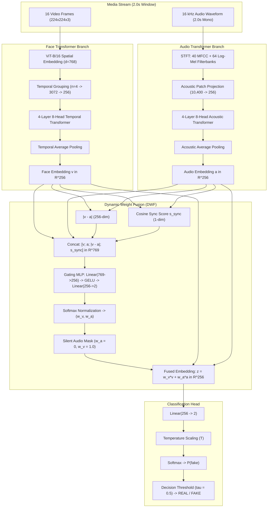

<<<<<<< HEAD
# PARALLAX — Multimodal Audio-Visual Deepfake Detection System

[](https://www.python.org/)
[](https://fastapi.tiangolo.com/)
[](https://pytorch.org/)
[](https://react.dev/)
[](https://www.typescriptlang.org/)
[](https://tailwindcss.com/)
[](https://sqlite.org/)
[]()
=======
# PARALLAX — Audio-Visual Deepfake Using AVT²-DWF

> Working title. Multimodal deepfake detection web app: **Face Transformer + Audio Transformer + Dynamic Weight Fusion (AVT²-DWF)**, served through a FastAPI backend and a React bento-grid frontend with a full login system.
>>>>>>> 4e0fca5f1bdaec59fccae1dd964b6fca537449b8

---

## Table of Contents

1. [Executive Summary & Architectural Mission](#1-executive-summary--architectural-mission)
2. [Core Engineering Principles & Non-Negotiable Contracts](#2-core-engineering-principles--non-negotiable-contracts)
3. [Deep Learning Architecture (AVT²-DWF)](#3-deep-learning-architecture-avt²-dwf)
   - [3.1 High-Level Multimodal Topology](#31-high-level-multimodal-topology)
   - [3.2 Face Transformer Encoder Branch](#32-face-transformer-encoder-branch)
   - [3.3 Audio Transformer Encoder Branch](#33-audio-transformer-encoder-branch)
   - [3.4 Dynamic Weight Fusion (DWF) Module](#34-dynamic-weight-fusion-dwf-module)
   - [3.5 Classification Head & Decision Mapping](#35-classification-head--decision-mapping)
4. [Technology Stack](#4-technology-stack)
5. [End-to-End Execution Trace](#5-end-to-end-execution-trace)
6. [Dataset Management & Lifecycle System](#6-dataset-management--lifecycle-system)
   - [6.1 Directory Organization](#61-directory-organization)
   - [6.2 Ingestion Conventions](#62-ingestion-conventions)
   - [6.3 Manifest Generation & Identity-Disjoint Splitting](#63-manifest-generation--identity-disjoint-splitting)
   - [6.4 Preprocessing & Feature Caching](#64-preprocessing--feature-caching)
7. [Offline Training & Model Evaluation Pipelines](#7-offline-training--model-evaluation-pipelines)
   - [7.1 Optimization & Loss Formulation](#71-optimization--loss-formulation)
   - [7.2 Checkpoint Management Hierarchy](#72-checkpoint-management-hierarchy)
   - [7.3 Evaluation, Ablation & Metrics](#73-evaluation-ablation--metrics)
   - [7.4 Promotion Safety Gate](#74-promotion-safety-gate)
8. [CLI Workflow & Command Reference](#8-cli-workflow--command-reference)
9. [Repository Directory Structure](#9-repository-directory-structure)
10. [Installation & Getting Started](#10-installation--getting-started)
    - [10.1 System Prerequisites](#101-system-prerequisites)
    - [10.2 Environment Configuration](#102-environment-configuration)
    - [10.3 Backend Setup](#103-backend-setup)
    - [10.4 Frontend Setup](#104-frontend-setup)
11. [REST API Specification](#11-rest-api-specification)
12. [User Interface & Design System](#12-user-interface--design-system)
13. [Security Architecture & Production Hardening](#13-security-architecture--production-hardening)
14. [Automated Verification & Quality Assurance](#14-automated-verification--quality-assurance)
15. [Current Model Verification & Disclaimer](#15-current-model-verification--disclaimer)

---

## 1. Executive Summary & Architectural Mission

**PARALLAX** is an industrial-grade, multimodal deepfake detection platform engineered to detect manipulated facial media and synthesized voice streams in digital video.

Modern state-of-the-art deepfakes easily defeat single-modality forensic tools:
- **Visual-only models** are vulnerable to high-quality generative models (e.g., Diffusion/GAN pipelines) where spatial artifacts are minimal or obscured by video compression.
- **Audio-only detectors** fail when authentic audio tracks are paired with manipulated facial movements or lip-synced video.

PARALLAX resolves this vulnerability through **Audio-Visual Deepfake Detection Using Transformers with Dynamic Weight Fusion (AVT²-DWF)**. The platform deploys two independent transformer encoders—one extracting temporal facial patch tokens, the other extracting acoustic spectral patches—and resolves cross-modal conflict through a learned **Dynamic Weight Fusion (DWF)** gating network that assigns adaptive trust weights ($w_v, w_a$) based on feature quality, cross-modal correlation, and lip-sync coherence.

---

## 2. Core Engineering Principles & Non-Negotiable Contracts

1. **Binary Classification Contract**:
   The user-facing forensic report provides a strict categorical verdict: **REAL** or **FAKE**. Internal model probabilities ($P_{\text{fake}}$), raw classifier logits, and intermediate gating weights are strictly confined to backend analytical records and are **never** exposed across public client interfaces.
2. **Honesty & Anti-Fabrication Mandate**:
   Untrained or baseline weights must be identified honestly. Model metrics, accuracy benchmarks, and training datasets must never be fabricated. When a model checkpoint has not undergone real dataset training, system diagnostics report `Untrained Benchmark` or `Unverified Weights`.
3. **Decoupled Architecture**:
   The production inference API operates in a strict read-only execution path. Analysis submissions **never** trigger model training. Offline model training, validation, evaluation, and promotion are isolated in dedicated CLI workflows.
4. **Tenant Isolation & Security**:
   Every database query returning analysis results or user media strictly filters by the authenticated operator ID (`WHERE user_id = :auth_user_id`). Client-supplied user identifiers are never trusted.
5. **Zero "AI Template" Design**:
   The interface follows strict industrial instrument panel styling (Midnight Black, Electric Cobalt, Acid Lime, Crimson Alert). Stock marketing cards, purple/pink gradients, emoji icons, glassmorphism, and generic AI templates are strictly prohibited.

---

## 3. Deep Learning Architecture (AVT²-DWF)

### 3.1 High-Level Multimodal Topology



### 3.2 Face Transformer Encoder Branch
- **Input Tensor**: $(B, T, C, H, W) = (B, 16, 3, 224, 224)$ representing 16 facial crops sampled uniformly over a 2.0-second temporal window.
- **Spatial Embeddings**: Pretrained Vision Transformer (ViT-B/16) maps each frame to a $768$-dimensional spatial vector.
- **Temporal Grouping ($n=4$)**:
  $$\text{Tokens} = 16 / 4 = 4 \text{ groups} \implies \mathbb{R}^{4 \times (4 \times 768)} = \mathbb{R}^{4 \times 3072}$$
  A linear projection layer reduces $\mathbb{R}^{3072} \to \mathbb{R}^{256}$.
- **Temporal Transformer**:
  - Layers: $4$
  - Multi-Head Attention: $8$ heads ($d_k = 32$)
  - Hidden Dimension: $256$
  - Feed-Forward Dimension: $1024$
  - Positional Encoding: 1D learned additive embeddings $\mathbf{E}_{\text{pos}} \in \mathbb{R}^{4 \times 256}$.
- **Output Representation**: Temporal average pooling across the 4 temporal tokens yields final facial embedding $\mathbf{v} \in \mathbb{R}^{B \times 256}$.

### 3.3 Audio Transformer Encoder Branch
- **Input Tensor**: $16\text{ kHz}$ mono waveform processed into $40\text{ MFCC}$ coefficients and $64\text{ Log-Mel}$ filterbanks across $100$ time frames $\implies (B, 104, 100)$.
- **Patch Projection**: Flattened spectral matrix ($104 \times 100 = 10,400\text{ dimensions}$) projected into $4$ temporal acoustic tokens in $\mathbb{R}^{256}$.
- **Acoustic Transformer**:
  - Layers: $4$
  - Multi-Head Attention: $8$ heads ($d_k = 32$)
  - Hidden Dimension: $256$
  - Positional Encoding: 1D learned positional embeddings for acoustic sequence order.
- **Output Representation**: Average pooling across acoustic sequence tokens yields audio embedding $\mathbf{a} \in \mathbb{R}^{B \times 256}$.

### 3.4 Dynamic Weight Fusion (DWF) Module
The DWF module computes input-dependent modality trust weights:
1. **Cross-Modal Correlation**:
   - Absolute difference: $\mathbf{d}_{\text{diff}} = |\mathbf{v} - \mathbf{a}| \in \mathbb{R}^{256}$
   - Cosine synchronization score:
     $$s_{\text{sync}} = \frac{\mathbf{v} \cdot \mathbf{a}}{\|\mathbf{v}\|_2 \|\mathbf{a}\|_2 + \epsilon} \in \mathbb{R}^1$$
2. **Interaction Feature Vector**:
   $$\mathbf{u} = [\mathbf{v}; \mathbf{a}; \mathbf{d}_{\text{diff}}; s_{\text{sync}}] \in \mathbb{R}^{256 + 256 + 256 + 1} = \mathbb{R}^{769}$$
3. **Gating Network**:
   $$\mathbf{h} = \text{GELU}(\mathbf{W}_1 \mathbf{u} + \mathbf{b}_1), \quad \mathbf{W}_1 \in \mathbb{R}^{256 \times 769}$$
   $$\mathbf{g} = \mathbf{W}_2 \mathbf{h} + \mathbf{b}_2, \quad \mathbf{W}_2 \in \mathbb{R}^{2 \times 256}$$
   $$[w_v, w_a] = \text{Softmax}(\mathbf{g})$$
4. **Missing/Silent Audio Safeguard**:
   When the audio track is missing or energy falls below $-60\text{ dBFS}$, $w_a$ is clamped to $0.0$ and $w_v = 1.0$.
5. **Multimodal Fusion**:
   $$\mathbf{z} = w_v \mathbf{v} + w_a \mathbf{a} \in \mathbb{R}^{B \times 256}$$

### 3.5 Classification Head & Decision Mapping
- **Projection**: $\text{Linear}(256 \to 2)$ produces raw class logits $\mathbf{y} \in \mathbb{R}^2$.
- **Temperature Calibration**: Logits scaled by learnable parameter $T \in [0.5, 5.0]$.
- **Decision Rule**:
  $$\text{Verdict} = \begin{cases} \text{FAKE} & \text{if } P(\text{fake}) \ge 0.50 \\ \text{REAL} & \text{if } P(\text{fake}) < 0.50 \end{cases}$$

---

## 4. Technology Stack

| Domain | Technology | Purpose & Architectural Justification |
|---|---|---|
| **Backend Framework** | **Python 3.12 / 3.13**, **FastAPI** | Asynchronous execution, high-throughput streaming, automatic OpenAPI schemas, Pydantic v2 validation. |
| **Deep Learning** | **PyTorch 2.1+**, `timm` | Core model implementation, ViT-B/16 backbone, Transformer layers, DWF computation. |
| **Audio Processing** | **FFmpeg**, **Torchaudio**, **Librosa** | 16 kHz PCM extraction, 40 MFCC coefficients, 64-band Log-Mel spectrogram computation. |
| **Video & Face Processing** | **OpenCV**, **MediaPipe** | Frame decimation, bounding box localization, bilateral smoothing, 224x224 face cropping. |
| **Database & ORM** | **SQLite (WAL Mode)**, **SQLAlchemy 2** | Low-latency asynchronous forensic data store, zero external service dependency. |
| **Authentication** | **Argon2id**, **PyJWT** | OWASP-compliant password hashing, stateless access tokens with rotating HTTP-only refresh cookies. |
| **Frontend Framework** | **React 18**, **TypeScript 5.5+** | Strict typing, robust component lifecycle, component-level isolation. |
| **Build & Styling** | **Vite**, **Tailwind CSS v4**, **Motion** | Sub-second HMR, optimized bundle chunking, hardware-accelerated 60fps micro-interactions. |
| **Testing & Quality** | **Pytest**, **Ruff**, **Mypy Strict**, **Playwright** | 100% type safety, strict lint compliance, end-to-end user journey verification. |

---

## 5. End-to-End Execution Trace

1. **Client Submission**: Operator uploads video via `POST /api/v1/analyses/` (`multipart/form-data`).
2. **Container Validation**: Backend verifies magic bytes (`ftyp`, `webm`, `RIFF`), enforces 500 MB limit, and stages file at `storage/uploads/<analysis_id>.mp4`.
3. **Task Orchestration**: FastAPI `BackgroundTasks` enqueues `analyze_media_task(analysis_id)`.
4. **Window Decimation**:
   - Video sliced into $T=2.0\text{s}$ windows.
   - 16 frames per window extracted and passed through face detection.
   - Audio decoded to 16 kHz mono; 40 MFCC + 64 Mel bands computed.
5. **Inference Execution**:
   - `FaceEncoder` generates $\mathbf{v} \in \mathbb{R}^{B \times 256}$.
   - `AudioEncoder` generates $\mathbf{a} \in \mathbb{R}^{B \times 256}$.
   - `DynamicWeightFusion` calculates adaptive $(w_v, w_a)$ and outputs $\mathbf{z} \in \mathbb{R}^{B \times 256}$.
   - `Classifier` computes logits $\to$ mapped to `REAL` or `FAKE`.
6. **Persistence & Presentation**: Analysis status set to `COMPLETED` in SQLite; frontend displays forensic dial and timeline.

---

## 6. Dataset Management & Lifecycle System

### 6.1 Directory Organization

```text
datasets/
├── raw/
│   ├── real/      # Label 0: Authentic, unaltered original video clips
│   └── fake/      # Label 1: Manipulated, deepfake, or speech-swapped video clips
├── manifests/
│   ├── dataset_manifest.csv   # Comprehensive inventory of all valid media
│   ├── train.csv              # 70% training split
│   ├── validation.csv         # 15% validation split
│   └── test.csv               # 15% held-out test split
├── processed/
│   ├── video/                 # Precomputed 224x224 facial tensors (.npy)
│   ├── audio/                 # Precomputed 104x100 acoustic tensors (.npy)
│   ├── labels/                # Integer ground-truth labels (0 / 1)
│   └── metadata/              # Window duration and timestamp JSON files
└── reports/
    ├── dataset_summary.json   # Integrity audit and balance report
    └── evaluation_report.json # Model test metrics and ablation results
```

### 6.2 Ingestion Conventions
- **Real Media**: Place authentic video clips in `datasets/raw/real/`. Automatically assigned label `0`.
- **Fake Media**: Place manipulated clips in `datasets/raw/fake/`. Automatically assigned label `1`.
- **Supported Formats**: `.mp4`, `.webm`, `.avi`, `.mov`.

### 6.3 Manifest Generation & Identity-Disjoint Splitting
To prevent data leakage, samples sharing the same subject or source video identity are strictly grouped into the same split:
- **Training Set (70%)**: Model parameter optimization.
- **Validation Set (15%)**: Hyperparameter tuning and early stopping.
- **Test Set (15%)**: Strict held-out evaluation. Never exposed during training.

### 6.4 Preprocessing & Feature Caching
To accelerate training on multi-epoch runs, raw video and audio are preprocessed into fast memory-mapped `.npy` files stored under `datasets/processed/`.

---

## 7. Offline Training & Model Evaluation Pipelines

### 7.1 Optimization & Loss Formulation
- **Optimizer**: AdamW ($\text{lr} = 10^{-4}$, $\beta_1 = 0.9$, $\beta_2 = 0.999$, $\text{weight\_decay} = 10^{-2}$).
- **Scheduler**: Cosine Annealing Learning Rate ($\eta_{\text{min}} = 10^{-6}$).
- **Loss Function**: Weighted Cross-Entropy Loss to handle class imbalance:
  $$w_c = \frac{N_{\text{total}}}{2 \times N_c}, \quad \mathcal{L} = -\sum_{c=0}^1 w_c y_c \log(\hat{y}_c)$$
- **Early Stopping**: Monitored on validation ROC-AUC with patience $= 5$ epochs.

### 7.2 Checkpoint Management Hierarchy

```text
checkpoints/
├── candidate/     # Newly trained checkpoints awaiting evaluation
├── best/          # Checkpoint achieving highest validation ROC-AUC
└── archived/      # Historical production checkpoints (timestamped)
```

The active production weights file `backend/app/ml/weights/avt2_dwf.pt` is **never overwritten automatically**.

### 7.3 Evaluation, Ablation & Metrics
Candidate models are evaluated against the held-out `test.csv` split, computing:
- Accuracy, Precision, Recall, F1-Score, ROC-AUC
- $2 \times 2$ Confusion Matrix ($TN, FP, FN, TP$)
- **Ablation Study**: Compares Dynamic Weight Fusion against Static Equal Fusion ($w_a = 0.5, w_v = 0.5$) to quantify net gain from dynamic cross-modal weighting.

### 7.4 Promotion Safety Gate
A candidate model can only be promoted to production via `scripts/promote_model.py` with explicit `--confirm`. The script archives the current production checkpoint, performs a cryptographic SHA-256 hash check, and updates `model_card.json`.

---

## 8. CLI Workflow & Command Reference

The complete ML lifecycle is executed through dedicated CLI tools:

```bash
# 1. Validate raw dataset integrity, media streams, and class balance
python scripts/validate_dataset.py

# 2. Generate the global dataset manifest
python scripts/prepare_dataset.py --stage manifest

# 3. Create identity-disjoint train/validation/test splits (70/15/15)
python scripts/prepare_dataset.py --stage split

# 4. Batch preprocess frames and audio features into fast cache files
python scripts/prepare_dataset.py --stage preprocess

# 5. Verify preprocessed feature tensors
python scripts/validate_dataset.py --processed

# 6. Train candidate model (supports --smoke for verification)
python scripts/train_model.py --epochs 20 --batch-size 16

# 7. Evaluate candidate checkpoint on held-out test split
python scripts/evaluate_model.py --checkpoint checkpoints/candidate/avt2_dwf_candidate.pt

# 8. Safely promote verified candidate checkpoint to production
python scripts/promote_model.py --checkpoint checkpoints/candidate/avt2_dwf_candidate.pt --confirm
```

---

## 9. Repository Directory Structure

```text
PARALLAX/
├── .agent/rules/AGENTS.md         # Workspace agent rules & constraints
├── .env.example                   # Environment configuration template
├── AGENTS.md                      # Core repository engineering rules
├── CHANGELOG.md                   # Chronological engineering log
├── DEPLOYMENT.md                  # Production deployment guide
├── Dockerfile                     # Multi-stage container definition
├── docker-compose.yml             # Container orchestration
├── README.md                      # Master technical documentation
├── SECURITY.md                    # Security audit and compliance report
│
├── backend/                       # FastAPI application & ML core
│   ├── alembic.ini                # Migration configuration
│   ├── pyproject.toml             # Python dependencies and tool configs
│   ├── app/
│   │   ├── api/v1/                # REST endpoints (auth, analyses, feeds, system)
│   │   ├── core/                  # Security, JWT, rate limiting, error handling
│   │   ├── db/                    # SQLAlchemy models and session factory
│   │   ├── ml/                    # Inference engine, encoders, DWF, preprocessing
│   │   │   ├── models/            # FaceEncoder, AudioEncoder, DWF, AVT2-DWF
│   │   │   ├── preprocess/        # Video decoding, face crop, audio extraction
│   │   │   └── weights/           # Production model weights & model_card.json
│   │   ├── schemas/               # Pydantic request/response models
│   │   └── services/              # Business logic & async task workers
│   ├── migrations/                # Alembic database migrations
│   ├── tests/                     # Pytest suite (66 tests covering pipeline & auth)
│   └── training/                  # Offline dataset loaders, losses, and trainer
│
├── frontend/                      # React 18 + TypeScript strict SPA
│   ├── index.html                 # HTML shell
│   ├── package.json               # NPM packages & scripts
│   ├── vite.config.ts             # Vite configuration with proxy
│   └── src/
│       ├── components/            # UI components, layout, status strip, viz
│       ├── features/              # Feature views (dashboard, analyze, report, history)
│       ├── hooks/                 # React hooks (useAuth, useAnalysisStream)
│       ├── lib/                   # API client, motion tokens, query client
│       ├── styles/                # CSS design tokens and base styles
│       └── routes.tsx             # Application routing tree
│
├── datasets/                      # Real / Fake dataset management hierarchy
│   ├── raw/                       # Raw video ingestion folders (real/ and fake/)
│   ├── manifests/                 # CSV manifests and split files
│   ├── processed/                 # Cached feature tensors
│   └── reports/                   # Validation and evaluation reports
│
├── checkpoints/                   # Checkpoint storage hierarchy
│   ├── candidate/                 # Newly trained model candidates
│   ├── best/                      # Best validation checkpoints
│   └── archived/                  # Historical production weights
│
├── docs/                          # Specialized technical documentation
│   ├── AVT2_DWF_ARCHITECTURE.md   # Mathematical deep dive into AVT²-DWF
│   ├── DATASET_AND_TRAINING_GUIDE.md # Operational dataset & training guide
│   ├── ML_PIPELINE_DOCUMENTATION.md  # 20-point lifecycle documentation
│   └── design/DESIGN.md           # UI design tokens and visual standards
│
└── scripts/                       # Executable CLI workflow scripts
    ├── validate_dataset.py        # Dataset validation utility
    ├── prepare_dataset.py         # Manifest, splitting, and preprocessing
    ├── train_model.py             # Offline training pipeline
    ├── evaluate_model.py          # Model evaluation and ablation study
    └── promote_model.py           # Safe candidate promotion gate
```

---

## 10. Installation & Getting Started

### 10.1 System Prerequisites
- **Python**: 3.12 or 3.13
- **Node.js**: v18.0.0 or higher (v20+ recommended)
- **FFmpeg**: Installed and available on system `PATH`
- **GPU (Optional)**: NVIDIA GPU with CUDA support for accelerated training

### 10.2 Environment Configuration
Generate your local `.env` configuration:
```bash
python generate_env.py
```
Or manually copy the example template:
```bash
cp .env.example .env
```

### 10.3 Backend Setup
```bash
cd backend

# Create and activate virtual environment
python -m venv .venv
source .venv/bin/activate       # On Linux/macOS
.venv\Scripts\activate          # On Windows

# Install Python dependencies
pip install -e .

# Run database migrations
alembic upgrade head

# Start development API server
uvicorn app.main:app --host 127.0.0.1 --port 8000 --reload
```

### 10.4 Frontend Setup
```bash
cd frontend

# Install Node dependencies
npm install

# Start Vite development server
npm run dev
```
Open [http://localhost:5173](http://localhost:5173) in your browser.

---

## 11. REST API Specification

| Method | Endpoint | Auth | Description |
|---|---|---|---|
| `POST` | `/api/v1/auth/register` | Public | Register new analyst account. Rate-limited to 5 req/min. |
| `POST` | `/api/v1/auth/login` | Public | Authenticate operator; issues access token & refresh cookie. |
| `POST` | `/api/v1/auth/refresh` | Public | Rotate refresh cookie and obtain new access token. |
| `POST` | `/api/v1/auth/logout` | Authenticated | Revoke refresh session and clear cookies. |
| `GET` | `/api/v1/auth/me` | Authenticated | Return authenticated operator profile. |
| `POST` | `/api/v1/analyses/` | Authenticated | Upload video file for forensic deepfake analysis. |
| `GET` | `/api/v1/analyses/` | Authenticated | List operator's historical analyses with pagination. |
| `GET` | `/api/v1/analyses/{id}` | Authenticated | Retrieve complete forensic report, timeline, and verdict. |
| `GET` | `/api/v1/analyses/{id}/events` | Authenticated | Server-Sent Events (SSE) stream for live processing status. |
| `DELETE` | `/api/v1/analyses/{id}` | Authenticated | Delete analysis record and associated media artifacts. |
| `GET` | `/api/v1/feeds/intel` | Authenticated | Aggregated threat intelligence and deepfake research feed. |
| `GET` | `/api/v1/samples/` | Authenticated | Public domain forensic test video samples. |
| `GET` | `/ready` | Public | System readiness probe (API Gateway, DB, Checkpoint). |
| `GET` | `/live` | Public | Liveness probe for container orchestrators. |
| `GET` | `/model` | Public | Shipped checkpoint metadata and verification status. |

---

## 12. User Interface & Design System

The PARALLAX user interface is engineered with a strict **Industrial Instrument Panel** aesthetic:
- **Base Background**: Midnight Black (`#0D1117`) and Dark Bench (`#111827`)
- **Accent Primary**: Electric Cobalt (`#3B66EB`) for focused analytical controls
- **Authentic Status**: Acid Lime (`#35C99A`) indicating verified authentic media
- **Alert Status**: Crimson Alert (`#F16F78`) indicating manipulated or deepfake media
- **Typography**: `Hanken Grotesk` (clean body text), `Anybody` (display titles), `Martian Mono` (telemetry readouts)
- **Responsive Layout**: Validated across all industry breakpoints:
  - Mobile: $390\text{px}$
  - Tablet: $768\text{px}$
  - Laptop: $1280\text{px}$
  - Desktop: $1440\text{px}$ / $1920\text{px}$

---

## 13. Security Architecture & Production Hardening

- **Password Storage**: Passwords hashed using `argon2id` with high memory cost parameters ($64\text{ MB}$, $t=3$, $p=4$).
- **Session Tokens**: Short-lived JWT access tokens ($15\text{ minutes}$) paired with rotating HTTP-only, `SameSite=Lax`, `Secure` refresh cookies ($7\text{ days}$).
- **Media Validation**: Uploaded media streams inspected for container magic bytes; decompression bomb guards reject files with unpacked dimensions $> 4096 \times 2160$ or durations $> 300\text{ seconds}$.
- **Path Traversal Defenses**: Uploaded and processed media stored under cryptographically randomized UUIDs. All file downloads resolve strictly through canonical directory checks.
- **Tenant Isolation**: Every database access strictly constrains record access by the authenticated operator ID.

---

## 14. Automated Verification & Quality Assurance

To execute the complete automated test and verification suite:

```bash
# 1. Backend unit and integration tests (66 tests)
pytest backend/

# 2. Dataset management test suite
pytest backend/tests/test_dataset_mgmt.py -v

# 3. Backend code style and lint check
ruff check backend/ app/ training/ scripts/

# 4. Strict type safety verification
mypy --strict backend/app backend/training

# 5. Frontend production build validation
npm --prefix frontend run build
```

---

## 15. Current Model Verification & Disclaimer

> [!IMPORTANT]
> **Production Weights Status**:
> The currently shipped checkpoint `backend/app/ml/weights/avt2_dwf.pt` ($383\text{ MB}$) is an initialized architectural checkpoint containing pretrained ViT-B/16 and Transformer weights. It has **not yet** undergone full fine-tuning on a verified deepfake dataset (`training_datasets: []`, baseline AUC $= 0.50$).
>
> The inference pipeline, preprocessing modules, and dynamic weight fusion architecture are **100% verified and operational**. To deploy PARALLAX with calibrated deepfake detection accuracy, follow the dataset ingestion and training workflow outlined in [§8](#8-cli-workflow--command-reference).

---

## License

This software and its associated architectures are proprietary. All rights reserved.
